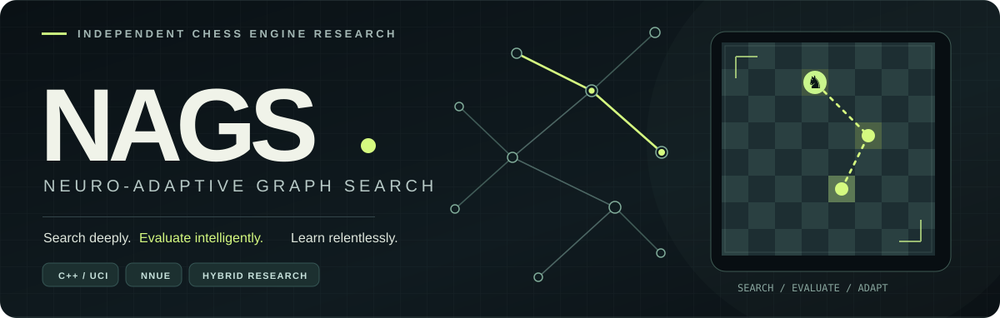
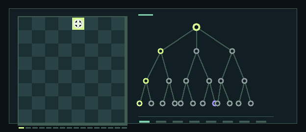
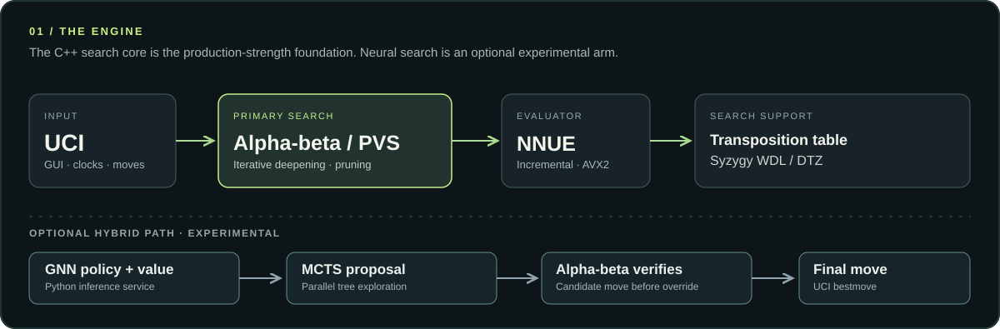

<div align="center">



<br/>

[](https://github.com/Cossy179/NAGS/actions/workflows/nags-ci.yml)
[](CMakeLists.txt)
[](requirements.txt)
[](#quick-start)
[](LICENSE)

**A chess engine built to ask a better question: how much intelligence can we extract from every millisecond of search?**

A serious C++ search engine, efficient NNUE evaluation, and a separate experimental neural-search laboratory. Every improvement earns its place through testing.

[**Get running**](#quick-start)　·　[**Explore the engine**](#architecture)　·　[**See the evidence**](#measured-progress)　·　[**Train & experiment**](#training--experimentation)

</div>

---

## Built to search. Built to learn.

<table>
<tr>
<td width="60%" valign="top">

### One project. Two approaches.

**01 / Search first.** A fast C++ alpha-beta/PVS engine built on magic bitboards, incremental NNUE, a transposition table, selective search and Syzygy endgames.

**02 / Learn to guide.** A separate experimental GNN produces move priors, values and uncertainty for MCTS. The hybrid only allows an MCTS move to displace the alpha-beta choice after verification.

**03 / Test everything.** Perft and regression tests guard correctness; benchmarks and SPRT matches decide whether a change really improves play.

> **The baseline is real. The hybrid is research.** `nags_enhanced` is the strongest established alpha-beta variant. The optional GNN/MCTS path is not presented as a proven strength gain.

</td>
<td width="40%" valign="middle" align="center">



<sub><b>Search space, visualised.</b> Custom looping illustration, not a recorded NAGS search or performance measurement.</sub>

</td>
</tr>
</table>

### What’s inside?

| | Capability | Details |
|:--|:--|:--|
| `01` | **Efficient board representation** | Magic-bitboard attacks, mailbox piece lookup, incremental Zobrist hashing |
| `02` | **Selective game-tree search** | PVS, aspiration windows, null-move pruning, LMR, SEE, singular extensions, history heuristics |
| `03` | **Neural evaluation** | Incremental NNUE, piece-count buckets, optional king buckets, SIMD / AVX2 paths |
| `04` | **Endgames with certainty** | Syzygy WDL / DTZ via Fathom |
| `05` | **Experimental hybrid** | GNN policy/value inference, parallel MCTS, alpha-beta verification, optional meta-learner |
| `06` | **Measurable engineering** | Multi-platform CI, tests, reproducible bench fingerprints, paired-opening SPRT |

## Architecture



The production-strength search path is implemented in C++. The GNN and meta-learner are optional Python services; if they're unavailable, the `nags` executable continues with its alpha-beta engine. **The illustrated hybrid branch is experimental**, not a claim of superior Elo.

<details>
<summary><b>Which executable should I use?</b></summary>

<br/>

| Executable | Purpose |
|:--|:--|
| **`nags_enhanced`** | Recommended pure alpha-beta engine: FastBoard, NNUE, transposition table, Lazy SMP |
| `nags` | Hybrid entry point; same C++ search with an optional GNN/MCTS arm and meta-learner |
| `nags_fast` | FastBoard and shared search, without a transposition table |
| `nags_basic` | Reference implementation using the simpler ray-based board |

</details>

## Quick start

**Requirements:** CMake 3.15+, a C++17 compiler (GCC, Clang or MSVC), and optionally Python 3.9+ for neural services/training.

```bash
git clone https://github.com/Cossy179/NAGS.git
cd NAGS

cmake -S . -B build -DCMAKE_BUILD_TYPE=Release
cmake --build build --config Release --parallel
```

**Play with a chess GUI.** Add `nags_enhanced` (or `nags`) as a UCI engine in Arena, Cute Chess, BanksiaGUI or another UCI-compatible interface.

**Or search directly:**

```bash
# Linux / macOS
printf 'uci\nisready\nposition startpos\ngo depth 12\n' | ./build/nags_enhanced
```

```powershell
# Windows PowerShell (Visual Studio generator)
.\build\Release\nags_enhanced.exe
# In the interactive engine:
# uci
# isready
# position startpos
# go depth 12
```

The NNUE network is embedded when available. The Python services are **not** required to run the recommended `nags_enhanced` engine.

<details>
<summary><b>Useful UCI options</b></summary>

<br/>

| Option | What it controls |
|:--|:--|
| `Hash` | Transposition-table memory |
| `Threads` | Lazy SMP worker count |
| `MultiPV` | Number of reported candidate lines |
| `RepetitionRule` | `Twofold` (default): any earlier occurrence of a position is a draw, the stronger search heuristic; `Laws`: a position from before the search only draws at its third occurrence, so a second occurrence is not scored as a draw (for analysis; changing it clears the hash) |
| `UseNNUE` / `EvalFile` | Enable NNUE or select a compatible network |
| `SyzygyPath` / `SyzygyProbeLimit` | Endgame tablebase probing |
| `Move Overhead` | Reserve time for GUI/system latency |
| `UseNN` / `NNHost` / `NNPort` | Optional neural MCTS service (hybrid `nags`; off by default) |
| `NNBatch` / `NNPipeline` / `NNCache` | Leaves per network request (virtual loss), two requests in flight, evaluation cache in MB (hybrid `nags`) |
| `NNGraphs` | Send each position's GNN graph, built by the engine, so the server need not build it (same replies; hybrid `nags`) |
| `MctsReuse`, `MctsSmartStop`, `MctsTTValue`, `NNRootOrder`, … | Experimental hybrid search options, off by default ([list](docs/ARCHITECTURE.md#hybrid-search-options)) |
| `UseMetaLearner` | Optional search-parameter adaptation (hybrid `nags`; off by default) |

Run `uci` for the full live option list.

</details>

## Measured progress

<div align="center">

### Progress isn't a slogan. It's a match result.

</div>

| Historical milestone | Reported result | Context |
|:--|--:|:--|
| 03 Oct 2026 | **2,329 ± 52** | Early calibration |
| 04 Oct 2026 | **2,881 ± 34** | Search improvements + NNUE network 5 |
| 06 Oct 2026 | **2,944 ± 34** | NNUE network 7 |
| 07 Oct 2026 | **2,994 ± 32** | Additional search improvements |
| 23 Oct 2026 | **3,111 ± 34** | October search work, network 7 |
| 23 Oct 2026 | **3,115 ± 31** | NNUE network 8 (king buckets + SCReLU, 201.7M positions), Windows PC |

These figures are estimates on **Stockfish's strength-limited `UCI_Elo` ladder at 10+0.1**. They are **not** ratings against unrestricted Stockfish, nor directly comparable with tournament Elo. The historical Windows AVX2 benchmark reported up to **1.48 million nodes per second** on the documented test machine; that number varies with hardware, build and workload. The default network (network 8: 4 king buckets + SCReLU, +209.6 ± 41.7 Elo over network 7 at 3+0.03) was trained using **201.7 million positions**.

The full context, uncertainty and rejected experiments matter. See **[testing history and methodology →](docs/TESTING.md)**.

## Training & experimentation

> [!IMPORTANT]
> **An NNUE training run is in progress.** Development must preserve the active run's checkpoint, input-feature and network-format compatibility. Do not overwrite datasets, rebuild binaries in use or restart a training job merely to follow a README example. New incompatible architectures belong in isolated, versioned experiments.

<table>
<tr>
<td valign="top" width="68%">

### From positions to evaluations

The NNUE workflow supports self-play generation, training, candidate evaluation and promotion only after match testing. The hybrid GNN has a separate supervised-learning and self-play pipeline. They are **different models serving different purposes**.

Explore the existing commands, formats and safeguards in [**NNUE training guide**](docs/NNUE.md) and [**training pipeline**](training_pipeline.py).

For the optional GNN RPC service, once you have a trained compatible model:

```bash
python -m pip install -r requirements.txt
python rpc_server.py --model models/production_model.pth
```

The server warns if it is launched without a trained checkpoint. Its use is optional. On a GPU, batch the engine's requests (`setoption name NNBatch value 32`, `NNPipeline true`); `--backend onnx` (with `requirements-onnx.txt`) runs a v3 network through ONNX Runtime, including its CUDA and TensorRT providers. See [neural inference](docs/ARCHITECTURE.md#neural-inference-relational_fastpy-gnn_inferpy-rpc_serverpy-nagscpp).

</td>
<td valign="middle" align="center" width="32%">


<sub><b>Another kind of search problem.</b><br/>Public-domain [knight's-tour animation](https://commons.wikimedia.org/wiki/File:Knight%27s_tour_anim_2.gif) by Ilmari Karonen (CC0). An educational illustration, not NAGS gameplay.</sub>

</td>
</tr>
</table>

### The research backlog

- Faster move picking and more selective search without tactical regressions
- Better policy learning targets and legal-action representations
- GPU measurements of the new batched inference path (implemented and tested on the CPU: MCTS 41 → 250 simulations/s), and graph construction in C++
- NNUE designs compared **at equal thinking time**, not only by validation loss
- Transparent, statistically sound matches against stronger unrestricted opponents

Proposed work is just that—**proposed**, not implemented or measured.

## Prove it

```bash
# C++ correctness, perft, search and UCI tests
ctest --test-dir build --build-config Release --output-on-failure

# Python model, service and training tests
python -m pytest -q

# Deterministic bench fingerprint + nodes/second
./build/nags_enhanced bench
```

Strength changes are admitted by controlled matches, using paired openings and sequential probability ratio testing (SPRT). Full reproduction instructions: [**docs/TESTING.md**](docs/TESTING.md).

## Documentation

| Read | What you'll find |
|:--|:--|
| [**Architecture ↗**](docs/ARCHITECTURE.md) | Board representation, engine internals and hybrid control |
| [**NNUE ↗**](docs/NNUE.md) | Network formats, self-play data generation and training |
| [**Testing ↗**](docs/TESTING.md) | Benchmarks, strength logs, SPRT and absolute-rating caveats |
| [**Compatibility ↗**](docs/COMPATIBILITY.md) | What networks in training depend on, and the checks before every merge |
| [**Training pipeline ↗**](training_pipeline.py) | GNN parsing, supervised training, self-play and evaluation; experimental v3 `label` / `distill` |

<div align="center">

---

<sub>Crafted for chess research. Backed by reproducible results.</sub>

**NAGS** · [Source](https://github.com/Cossy179/NAGS) · [CI](https://github.com/Cossy179/NAGS/actions/workflows/nags-ci.yml) · [MIT license](LICENSE)

</div>
