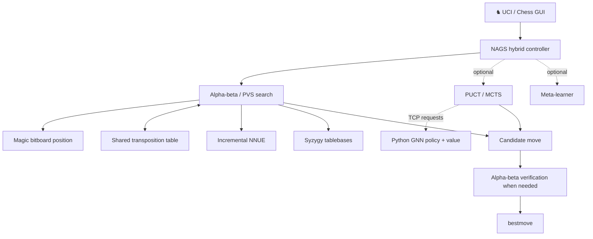

<div align="center">

# ♞ NAGS

### N E U R O · A D A P T I V E · G R A P H · S E A R C H

**Search deeply. Evaluate intelligently. Learn relentlessly.**

An open-source chess engine research project combining high-performance **C++ alpha-beta search**, **incremental NNUE evaluation**, and an experimental **graph-neural-network-guided MCTS** system.

[](https://github.com/Cossy179/NAGS/actions/workflows/nags-ci.yml)
[](CMakeLists.txt)
[](requirements.txt)
[](#quick-start)
[](LICENSE)

**[Get started](#quick-start)** &nbsp;·&nbsp; **[Explore the architecture](#under-the-hood)** &nbsp;·&nbsp; **[See the benchmarks](#measured-progress)** &nbsp;·&nbsp; **[Read the research docs](#documentation)**

---

### THE ENGINE AT A GLANCE

| ♟️ **56.5M** | ⚡ **1.48M** | 🎯 **2,994 ± 32** | 🧠 **4** |
|:---:|:---:|:---:|:---:|
| Positions behind NNUE Network 7 | Nodes/sec in a reported Windows AVX2 bench | Estimated on a **strength-limited** Stockfish UCI_Elo ladder | UCI engine variants |

<sub>Historical measurements from October 2026; see [testing methodology](docs/TESTING.md). Nodes/sec is hardware/build-specific. The Elo estimate is **not** a rating against unrestricted Stockfish, and it is not a universal chess Elo.</sub>

</div>

> [!IMPORTANT]
> **Active development · New NNUE training in progress.** NAGS is being actively developed while a new network is trained. Changes to network formats, feature encodings, inference, or trainer interfaces must preserve compatibility with the ongoing run. Experimental architectures belong on isolated branches until they are validated. The checked-in network remains the reference until a new candidate wins its evaluation matches.

## What makes NAGS different?

NAGS is a chess-engine laboratory with a practical goal: find which combinations of **classical search**, **efficient neural evaluation**, and **learned search guidance** actually win games under real time limits.

- **Fast search core** — magic bitboards, iterative deepening, principal variation search, aspiration windows, null-move and futility pruning, late-move reductions, singular extensions, and history-based ordering.
- **Incremental NNUE** — efficient accumulator updates, piece-count output buckets, optional king-bucket architectures, SCReLU experimentation, and AVX2 inference kernels.
- **Experimental neural search** — a GNN predicts policy priors, value and uncertainty for a parallel PUCT/MCTS arm; alpha-beta verifies potential move overrides.
- **Serious endgame support** — Syzygy WDL/DTZ probing via Fathom.
- **Evidence over hype** — deterministic bench fingerprints, paired-opening matches, SPRT testing, and documented *failed* experiments.
- **Runs without neural services** — the hybrid gracefully falls back to its full C++ alpha-beta engine if the optional Python services are unavailable.

## Under the hood



The **strongest established standalone search build** is `nags_enhanced`. The `nags` executable adds an optional experimental hybrid controller; its GNN/MCTS component should not be assumed stronger without direct match evidence.

### Choose your engine

| Engine | Board / search | Neural evaluation | Best for |
|:---|:---|:---|:---|
| **`nags_enhanced`** | Magic bitboards · TT · Lazy SMP | NNUE | **Recommended:** everyday analysis, engine matches and benchmarks |
| **`nags`** | Enhanced search + optional MCTS verification | NNUE + optional GNN | Hybrid and neural-search experiments |
| `nags_fast` | Magic bitboards · no TT | NNUE | Measuring the impact of transpositions |
| `nags_basic` | Ray-based bitboards · no TT | Classical evaluation | Reference implementation and comparisons |

<details>
<summary><b>Technical highlights: what's inside the search?</b></summary>

<br>

| Component | Implementation |
|:---|:---|
| Search | Iterative deepening, aspiration windows, principal variation search |
| Selectivity | Null-move pruning, reverse futility, late-move pruning/reductions, SEE pruning, internal iterative reductions |
| Tactics | Quiescence search, checks, singular extensions, mate-distance bounds |
| Move ordering | TT moves, capture SEE, killers, counter-moves, history and continuation history |
| Position representation | Incremental Zobrist hashing, mailbox + magic-bitboard attacks |
| Parallelism | Lazy SMP workers sharing a lockless transposition table |
| Endgames | Syzygy tablebase WDL and root DTZ via Fathom |
| NNUE | Embedded network, optional `EvalFile`, lazy accumulators and SIMD kernels |

For implementation details, read **[Architecture](docs/ARCHITECTURE.md)** and **[NNUE](docs/NNUE.md)**.

</details>

## Quick start

### 1. Clone and build

**Requirements:** CMake **3.15+** and a **C++17 compiler** (GCC, Clang, or MSVC). Python is not required to run the C++ engines.

```bash
git clone https://github.com/Cossy179/NAGS.git
cd NAGS
cmake -S . -B build -DCMAKE_BUILD_TYPE=Release
cmake --build build --config Release --parallel
```

The executables are normally in `build/` on Linux/macOS and `build/Release/` for multi-configuration Visual Studio builds on Windows.

### 2. Play or analyse with a UCI GUI

Load **`nags_enhanced`** as a UCI engine in your preferred interface, such as Arena, Cute Chess, or BanksiaGUI. The default NNUE is embedded in the binary.

Alternatively, run it from a terminal:

```bash
# Linux / macOS
./build/nags_enhanced
```

```powershell
# Windows PowerShell (Visual Studio multi-config build)
.\build\Release\nags_enhanced.exe
```

Then send UCI commands (the engine outputs `info` lines and a `bestmove`):

```text
uci
isready
setoption name Hash value 256
setoption name Threads value 4
position startpos moves e2e4 e7e5 g1f3
go depth 14
```

You can also run a self-contained benchmark:

```bash
./build/nags_enhanced bench
```

> [!TIP]
> On Windows, substitute `build\Release\nags_enhanced.exe` for `./build/nags_enhanced` in benchmark commands.

### Useful UCI options

| Option | Purpose |
|:---|:---|
| `Hash` / `Threads` | TT size in MB / Lazy SMP worker count (`nags`, `nags_enhanced`) |
| `UseNNUE` / `EvalFile` | Toggle NNUE or select a compatible network file |
| `MultiPV` / `Ponder` | Analyse multiple lines / configure pondering |
| `SyzygyPath` / `SyzygyProbeLimit` | Enable supported endgame tablebases |
| `UseNN` / `NNHost` / `NNPort` | Enable/configure experimental GNN guidance on `nags` |
| `UseMetaLearner` | Enable experimental per-move search-parameter adjustments on `nags` |
| `MctsMinTime` | Minimum soft time budget needed to launch the optional MCTS arm |

See the UCI option table in the [original architecture documentation](docs/ARCHITECTURE.md) and the option declarations in `src/` for exact defaults.

## The neural side

NAGS contains **two distinct neural subsystems**. They serve different purposes and should not be confused.

| | **NNUE** | **GNN / policy-value** |
|:---|:---|:---|
| Role | Fast static position evaluation inside alpha-beta | Move priors, value and uncertainty for experimental MCTS |
| Runtime | In-process C++ / CPU | Optional Python service (PyTorch / PyG) |
| Model path | `nets/nags.nnue` (embedded at build time) | `models/production_model.pth` (when trained and available) |
| Training | `tools/nnue/` | `training_pipeline.py` |
| Required to play? | No; classical evaluation is the fallback | No; hybrid falls back to enhanced alpha-beta |

### Run the optional GNN service

Install Python dependencies in a dedicated environment, then start the evaluator. A trained checkpoint is needed for meaningful GNN-guided decisions.

```bash
python -m pip install -r requirements.txt
python rpc_server.py --model models/production_model.pth
```

In another terminal, start the hybrid engine and enable its neural arm:

```text
setoption name UseNN value true
position startpos
go movetime 3000
```

The optional meta-learner runs independently with `python meta_learner.py`. The server can start with an untrained model when no checkpoint is found, but **untrained predictions are not evidence of chess strength**.

### Training new networks

The NNUE pipeline generates data, trains candidate architectures, evaluates them through matches, and promotes only a successful candidate. Read **[NNUE training](docs/NNUE.md)** before launching it.

```bash
# Resource-intensive example — do not launch a second run over active outputs
python tools/nnue/run_round.py --target-positions 200000000 --threads 11
```

The GNN pipeline supports PGN parsing, supervised learning, hybrid self-play, experimental PPO, evaluation and meta-learning:

```bash
git lfs pull                  # Fetch the large PGN training corpus if needed
python training_pipeline.py --help
# ./run_training.sh full     # Linux/macOS — see training_config.json
# run_training.bat full      # Windows
```

> [!CAUTION]
> **Protect in-progress training.** Never overwrite active checkpoint/data files, modify network formats incompatibly, or point experiments at the same output directory as a live training run. Introduce incompatible features only through versioned, backward-compatible loaders or isolated experiments. A freshly trained NNUE must remain loadable by the engine after code changes.

## Measured progress

NAGS tracks improvements with **paired-opening statistical matches**, not intuition alone.

| Historical milestone | Reported result | Context |
|:---|---:|:---|
| NNUE Network 7 | **56.5M** positions | 8 piece-count output buckets |
| Search batch, October 7, 2026 | **≈ +50 Elo** on the same Stockfish ladder | Relative to the preceding benchmark on that test setup |
| Calibrated build, October 7, 2026 | **2,994 ± 32** | Stockfish 16 `UCI_LimitStrength` / `UCI_Elo` ladder at 10+0.1 |
| MSVC AVX2 inference | **0.57M → 1.48M nodes/sec** | Reported `nags_enhanced` median on Ryzen 5 3500X; same bench node count |

**Read these numbers correctly:** `UCI_Elo` on a strength-limited Stockfish ladder at a short time control is a *rough comparative calibration*, not a published CCRL rating or a claim of parity with full-strength Stockfish. Bench speed depends on CPU, build, NNUE network and workload. The hybrid with a trained GNN has **not** been established as stronger than `nags_enhanced` in the documented results.

See **[full results, accepted and rejected experiments, and SPRT methodology](docs/TESTING.md)**.

## Test it. Challenge it. Improve it.

```bash
# C++ correctness tests (perft, search, hashing, UCI, NNUE, Syzygy)
ctest --test-dir build --build-config Release --output-on-failure

# Python services, training pipeline and statistics
python -m pytest -q

# Deterministic search fingerprint and measured nodes/second
./build/nags_enhanced bench
```

CI runs C++ builds/tests on **Linux, Windows and macOS**, plus Python tests on Linux. For engine-strength changes, use the paired-opening **[SPRT workflow](docs/TESTING.md#3-strength-sprt-matches-with-toolssprtpy)** and confirm promising results at longer time controls.

### Current research directions

- Faster, more selective alpha-beta search and improved move generation.
- Richer **NNUE architectures per unit of inference cost**.
- Correct, legal-action-aware policy training and evaluation targets.
- Better GPU inference batching and a tighter connection between policy guidance and alpha-beta search.
- Adaptive compute allocation backed by controlled engine matches.

These are **research directions, not features claimed to be finished**. Contributions should be tested independently and must preserve compatibility with any active model-training run.

## Documentation

| Guide | What you'll find |
|:---|:---|
| 📐 **[Architecture](docs/ARCHITECTURE.md)** | Boards, alpha-beta search, hybrid controller, GNN and meta-learner |
| 🧠 **[NNUE](docs/NNUE.md)** | Network formats, training, quantisation, incremental inference |
| 🧪 **[Testing & results](docs/TESTING.md)** | Perft, CI, benchmarks, SPRT, calibration and honest experiment logs |
| ⚙️ **[Training configuration](training_config.json)** | GNN pipeline settings and evaluation defaults |
| 🧰 **[NNUE tools](tools/nnue/)** | Data conversion, training and resumable training rounds |

---

<div align="center">

### ♞ NAGS — Every position is a problem worth solving.

**Built for experimentation. Measured by the moves it plays.**

[Source](https://github.com/Cossy179/NAGS) · [CI](https://github.com/Cossy179/NAGS/actions/workflows/nags-ci.yml) · [MIT License](LICENSE)

<sub>© 2025–2026 NAGS contributors · Open-source under the MIT License.</sub>

</div>